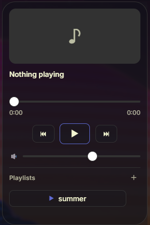

# Mini Player

A compact music player in the Obsidian sidebar. Start a playlist, skip a track, and see what is playing without leaving your notes.



This plugin is **only the interface**. It does not play audio itself — it controls [go-librespot](https://github.com/devgianlu/go-librespot), a lightweight Spotify Connect client that you install and run yourself.

## What this is (and what it is not)

- **It is** a small remote control for a local go-librespot instance, talking to its HTTP API on `localhost`.
- **It is not** a Spotify player. Obsidian cannot play Spotify audio directly: the Spotify Web Playback SDK requires the Widevine DRM module, which Obsidian's Electron build does not ship.
- **It does not** bundle, redistribute, or modify any Spotify software, and it does not circumvent any content protection.

## Requirements

- **A Spotify Premium account is required.** go-librespot does not work with free accounts, and this plugin cannot change that.
- **go-librespot must be installed and running** on the same machine, with its API server enabled.
- Desktop only (`isDesktopOnly: true`) — it needs a local HTTP server, which is not available on mobile.

## Network use

This plugin makes exactly two kinds of network requests. Nothing else leaves your machine.

| Destination | Purpose | When |
|---|---|---|
| `http://127.0.0.1:3678` (configurable) | Read playback status, send play / pause / next / seek / volume commands to go-librespot | While the player view is open (polled every 3 seconds), and on each button press |
| `https://api.spotify.com` | Look up the **name** of a playlist, album, artist or track | Only when you add an item and leave the display name blank |

The Spotify access token used for that name lookup is obtained from go-librespot's own `POST /token` endpoint — this plugin never asks you for Spotify credentials and never stores them.

**There is no telemetry.** No usage data, no vault content, and no personal data is collected or transmitted.

## Setup

### 1. Install go-librespot

**macOS / Linux**

```
brew install go-librespot
```

**Windows**

The official Windows release is dynamically linked and will fail to start with an error such as
`error while loading shared libraries: libvorbisenc-2.dll`. It expects MinGW builds of `libogg`,
`libvorbis`, `flac` and `mpg123` to be present.

The simplest fix is to use the **statically linked build** that go-librespot's CI produces. With the
[GitHub CLI](https://cli.github.com/) installed and authenticated:

```
gh run list -R devgianlu/go-librespot --workflow="Build and Test" --status=success --limit 3
gh run download <RUN_ID> -R devgianlu/go-librespot -n go-librespot-windows-amd64-vcpkg
```

That gives you a single `go-librespot.exe` with no DLL dependencies.

Alternatively, install [MSYS2](https://www.msys2.org/) and the required libraries, then use the
official release:

```
pacman -S mingw-w64-x86_64-libogg mingw-w64-x86_64-libvorbis mingw-w64-x86_64-flac mingw-w64-x86_64-mpg123
```

### 2. Create `config.yml`

Save this next to the binary. The plugin's **Setup guide** (the `?` button, or Settings → Mini Player)
can copy it to your clipboard.

```yaml
device_name: Obsidian
device_type: computer
zeroconf_enabled: false
credentials:
  type: interactive
bitrate: 320
volume_steps: 100
initial_volume: 60
server:
  enabled: true
  address: localhost
  port: 3678
  allow_origin: '*'
```

### 3. Run it

```
go-librespot --config_dir <folder containing config.yml>
```

Note the **double dash** in `--config_dir`. A single dash is parsed as the short `-c` flag and fails
with `invalid config override format`.

### 4. Authorize once

On first run the log prints an `https://accounts.spotify.com/authorize?...` link. Open it and sign in
with your Spotify Premium account. Credentials are then stored in `state.json` and reused, so this is
a one-time step.

Until authorization completes, `GET /status` does not respond — so the plugin will show
**Not connected** even though the process is running.

## Keeping it running

go-librespot is a long-running service, and this plugin does not manage it —
starting, stopping and restarting it is left to your operating system, where
that job belongs. Set it up once and it will be there whenever Obsidian is.

### Linux — systemd user service

`~/.config/systemd/user/go-librespot.service`:

```ini
[Unit]
Description=go-librespot
After=network-online.target

[Service]
ExecStart=/usr/local/bin/go-librespot --config_dir %h/.config/go-librespot
Restart=always
RestartSec=5

[Install]
WantedBy=default.target
```

```
systemctl --user daemon-reload
systemctl --user enable --now go-librespot
```

### macOS — launchd agent

`~/Library/LaunchAgents/go-librespot.plist`:

```xml
<?xml version="1.0" encoding="UTF-8"?>
<!DOCTYPE plist PUBLIC "-//Apple//DTD PLIST 1.0//EN" "http://www.apple.com/DTDs/PropertyList-1.0.dtd">
<plist version="1.0">
<dict>
  <key>Label</key><string>go-librespot</string>
  <key>ProgramArguments</key>
  <array>
    <string>/opt/homebrew/bin/go-librespot</string>
    <string>--config_dir</string>
    <string>/Users/YOU/Library/Application Support/go-librespot</string>
  </array>
  <key>RunAtLoad</key><true/>
  <key>KeepAlive</key><true/>
</dict>
</plist>
```

```
launchctl load ~/Library/LaunchAgents/go-librespot.plist
```

### Windows

Put a shortcut in the startup folder (`Win+R` → `shell:startup`) so it launches
at sign-in. To avoid a console window, point the shortcut at a one-line VBScript
rather than the executable:

```vbscript
' start-go-librespot.vbs
Set ws = CreateObject("WScript.Shell")
ws.Run "cmd /c cd /d ""C:\path\to\go-librespot"" && go-librespot.exe --config_dir conf > run.log 2>&1", 0, False
```

Task Scheduler can also restart the task if it exits, under the task's
**Settings** tab.

### When it stops responding rather than exiting

Sometimes go-librespot keeps running but stops answering. The plugin shows
**Not responding**, and its log repeats `did not receive last pong ack from
accesspoint`. It tends to follow a network change or a wake from sleep
(upstream issues [#223](https://github.com/devgianlu/go-librespot/issues/223)
and [#300](https://github.com/devgianlu/go-librespot/issues/300)).

**A service manager will not catch this** — the process is alive, so nothing
looks wrong from the outside. Stop it and start it again. If it happens often
enough to bother you, add a periodic health check that requests `/status` and
restarts the service when it does not answer.

## Usage

- Click the **play** icon in the ribbon, or run **Mini Player: Open mini player** from the command palette.
- Press **＋** in the Playlists header and paste a Spotify URL. `https://open.spotify.com/playlist/…?si=…`
  works as-is and is converted to a URI automatically. Albums, artists and tracks work too.
- Hover a playlist to reveal **×** to remove it.
- Commands available for hotkeys: play/pause, next, previous, and choosing a saved playlist.

## Disclaimer

go-librespot is an independent, unofficial client that implements the Spotify Connect protocol
through reverse engineering. Its authors state:

> Using this code to connect to Spotify's API is probably forbidden by them. Use at your own risk.

Using it may conflict with the Spotify Terms of Use, and any consequences — including action against
your Spotify account — are your own responsibility. If you are not comfortable with that, do not
install go-librespot; this plugin is useless without it, which is by design: the choice stays with you.

## Credits

- [go-librespot](https://github.com/devgianlu/go-librespot) by devgianlu — GPL-3.0. It is **not** bundled
  with this plugin; you install it yourself, and it runs as a separate process.
- Spotify is a trademark of Spotify AB. This plugin is not affiliated with, endorsed by, or sponsored
  by Spotify AB.

## License

MIT — see [LICENSE](LICENSE).
